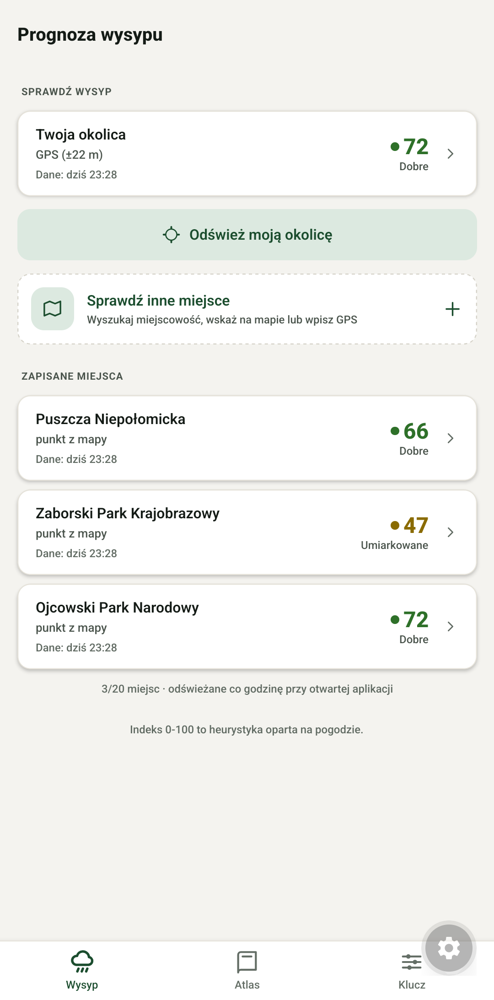
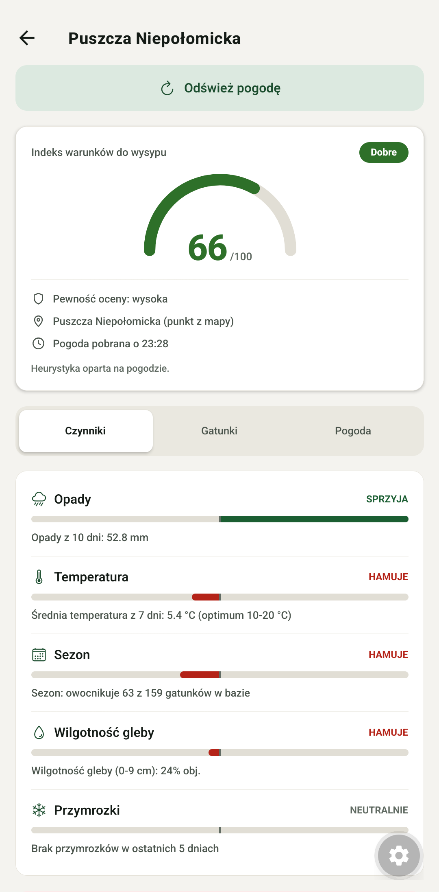
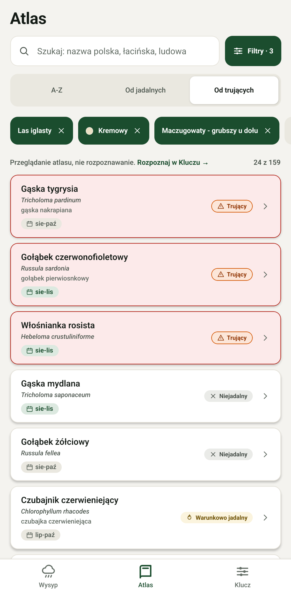
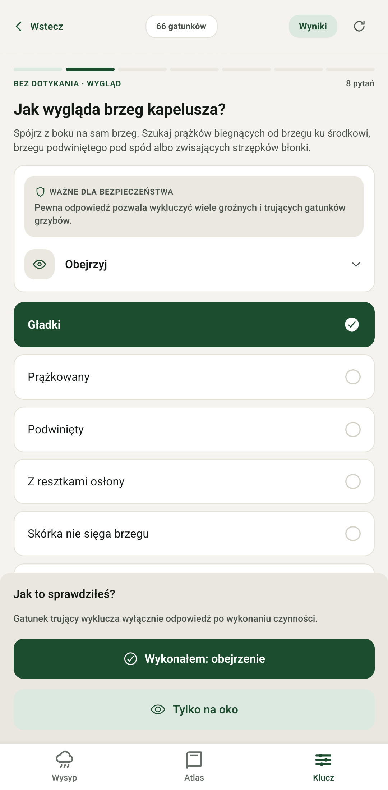

# Myco-App

Mobilna aplikacja grzybiarska zbudowana w React Native i Expo. Łączy lokalną bazę mykologiczną działającą w trybie 100% offline z modułem zdalnego monitoringu warunków pogodowych dla wybranych obszarów leśnych w Polsce.

## Główne funkcjonalności

### 100% Offline: Atlas gatunków i Klucz rozpoznawania
Wszystkie dane o gatunkach są spakowane w lokalnej bazie SQLite (`assets/db/myco.db`) w trybie tylko do odczytu, co zapewnia natychmiastowe działanie w terenie bez dostępu do sieci.

- **Atlas gatunków z filtrowaniem fasetowym:** Przeglądanie pełnej bazy z wyszukiwaniem pełnotekstowym (FTS5) po nazwach polskich, łacińskich i ludowych (bez konieczności wpisywania polskich znaków). Filtrowanie po cechach morfologicznych, siedlisku, drzewach mikoryzowych, sezonie owocnikowania oraz statusie ochrony i jadalności, z możliwością zapisywania własnych zestawów filtrów (do 12 presetów).
- **Klucz rozpoznawania z Bramką Bezpieczeństwa:** Wielodostępny klucz podzielony na 7 etapów obserwacji (Miejsce, Wygląd, Dotyk, Wykop, Przekrój, Zapach, Wysyp). System stosuje asymetrię dowodową: obserwacje subiektywne (np. barwa kapelusza, zapach) oraz odpowiedzi oznaczone "na oko" nigdy nie wykluczają gatunków trujących lub śmiertelnie trujących. Aplikacja celowo wyklucza pytania o próbę smaku.
- **Karty gatunków:** Zestawienie cech morfologicznych, kalendarz owocnikowania, ostrzeżenia toksykologiczne oraz sekcja niebezpiecznych sobowtórów ze wskazaniem cech rozstrzygających.

### Online z lokalnym cache: Monitoring warunków w zapisanych lokalizacjach
Moduł prognozy wysypu pozwala zdalnie ocenić warunki środowiskowe przed wyjściem w teren. Pobrane zrzuty pogodowe są zapisywane lokalnie w `AsyncStorage`, dzięki czemu ostatni pobrany stan pozostaje dostępny offline (także jako filtr "Sprzyjająca pogoda" w Atlasie i Kluczu).

- **Zdalny monitoring zapisanych lokalizacji:** Dodawanie i śledzenie do 20 wybranych obszarów leśnych przez wyszukiwarkę miejscowości (Open-Meteo Geocoding API), wskazanie punktu na mapie OpenStreetMap (Leaflet w WebView) lub ręczne wpisanie współrzędnych WGS84. Dane dla monitorowanych miejsc odświeżają się automatycznie co godzinę przy otwartej aplikacji.
- **Indeks wysypu (0-100):** Heurystyczna ocena warunków na podstawie danych historycznych z Open-Meteo Forecast API: sumy opadów (ostatnie 10 dni), średniej temperatury (7 dni), wilgotności gleby w warstwie 0-9 cm (3 dni), liczby dni z przymrozkami (5 dni) oraz aktualnego sezonu.
- **Rozbicie szczegółowe:** Podgląd wpływu poszczególnych czynników pogodowych, lista gatunków o najwyższym dopasowaniu do bieżących warunków oraz tabela surowych pomiarów dobowych.

## Zrzuty ekranu

| Prognoza i zapisane lokalizacje | Szczegóły warunków wysypu | Atlas i filtry fasetowe | Klucz rozpoznawania |
| :---: | :---: | :---: | :---: |
|  |  |  |  |
| Lista monitorowanych miejsc z indeksem wysypu (0-100) oraz szybkim dostępem do lokalizacji GPS i wyszukiwarki obszarów leśnych. | Rozbicie indeksu na czynniki środowiskowe (opady, temperatura, wilgotność gleby, przymrozki), lista dopasowanych gatunków i tabela pogody. | Baza gatunków offline z wyszukiwarką FTS5, sortowaniem po jadalności, oznaczeniami sezonu i dostępem do panelu filtrów cech. | Interaktywny klucz z 7-etapowym paskiem postępu, podpowiedziami terenowymi i Bramką Bezpieczeństwa chroniącą przed pomyłką. |

## Stos technologiczny

- **Rdzeń:** React Native, Expo, TypeScript, Expo Router
- **Baza danych i pamięć lokalna:** `expo-sqlite` (wbudowana baza z indeksem FTS5 i maskami bitowymi), `@react-native-async-storage/async-storage`, `expo-file-system`, `expo-asset`
- **Interfejs, animacje i listy:** `react-native-reanimated`, `react-native-gesture-handler`, `@shopify/flash-list`, `react-native-svg`, `expo-haptics`, `@expo/vector-icons`, `@react-native-community/slider`, `@miblanchard/react-native-slider`
- **Lokalizacja i mapy:** `expo-location`, `react-native-webview` (Leaflet 1.9.4 + kafelki OpenStreetMap)
- **Zewnętrzne API:** Open-Meteo Forecast API (dane pogodowe i wilgotność gleby), Open-Meteo Geocoding API (wyszukiwanie miejscowości w Polsce)
- **Testy:** Jest (testy jednostkowe silników, niezmienników bazy wiedzy i Bramki Bezpieczeństwa) oraz statyczne testy typów TypeScript

## Uruchomienie lokalne (Getting Started)

### Wymagania wstępne
- Node.js (zalecana wersja LTS) oraz npm
- Aplikacja Expo Go na telefonie lub skonfigurowany emulator Android / symulator iOS

### Instalacja i uruchomienie

1. Sklonuj repozytorium i przejdź do katalogu projektu:

```bash
git clone <adres-repozytorium>
cd myco-app
```

2. Zainstaluj zależności:

```bash
npm install
# Jeśli dodajesz lub synchronizujesz pakiety natywne Expo:
# npx expo install
```

3. Wygeneruj indeks gatunków i zbuduj lokalną bazę SQLite (`assets/db/myco.db`), jeśli plik bazy nie jest dołączony do repozytorium:

```bash
# Wygenerowanie pliku src/data/species/index.ts (jeśli wymagane po zmianach w danych):
node scripts/generate-species-index.mjs

# Zbudowanie pliku assets/db/myco.db (zweryfikuj dokładną nazwę skryptu w package.json):
npm run build:db
```

4. Uruchom serwer deweloperski Expo:

```bash
npx expo start
```

Zeskanuj kod QR w aplikacji Expo Go lub naciśnij `a` (Android) / `i` (iOS) w terminalu, aby otworzyć aplikację na emulatorze.

### Testy i weryfikacja typów

```bash
# Uruchomienie testów jednostkowych i walidacji bazy (zweryfikuj skrypt w package.json):
npm test

# Sprawdzenie typów TypeScript wraz z testami typów Bramki Bezpieczeństwa (src/__typetests__/):
npm run typecheck
```

## Platforma docelowa i środowisko testowe

- **System docelowy:** Aplikacja została przygotowana głównie z myślą o systemie **Android** (kod opiera się na React Native i Expo, więc zachowuje zgodność z iOS, jednak priorytetem był Android - m.in. konfiguracja `APP_USER_AGENT` dla WebView i obsługa uprawnień lokalizacji).
- **Testy na fizycznym urządzeniu:** Aplikacja została przetestowana na fizycznym urządzeniu z systemem Android - Nothing Phone 2 z Android 16 przez Expo Go, w tym w warunkach terenowych (tryb offline, GPS, odczyt lokalnej bazy SQLite).

## Zastrzeżenie bezpieczeństwa

Aplikacja ma charakter edukacyjny i wspomagający planowanie wyjść w teren. Lokalna baza nie obejmuje wszystkich gatunków występujących w Polsce, a indeks wysypu jest heurystyką pogodową. Nigdy nie spożywaj grzybów wyłącznie na podstawie wskazań aplikacji.
